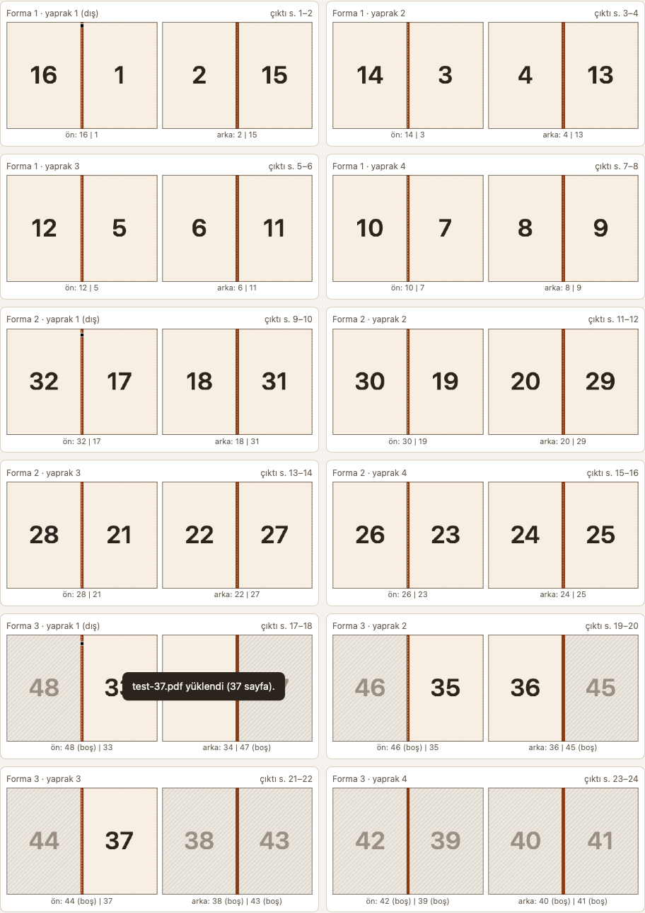

# Mücellit

> Mücellit (from Arabic mujallid) is the old Turkish word for a bookbinder; in the Ottoman palace, binders worked within the ehl-i hiref, the guild of court artisans (TDK dictionary; Kubbealtı Lugatı; TDV Encyclopedia of Islam, 'Ciltçilik').

A bookbinding helper that runs in your browser. It imposes a PDF (or an EPUB) into signatures for your printer,
calculates hardcover materials, tracks each binding project step by step and teaches the whole process with an
illustrated guide. Folding, sewing, gluing and covering are done by hand; the tool prepares and tracks.

**Live site:** `https://onrert.github.io/mucellit/`

Interface: English and Turkish. Türkçe açıklama aşağıda: [Türkçe](#türkçe).

## What it does

- **Imposition:** choose a PDF, or an EPUB, which is typeset into a PDF at your book size (Literata typeface, justified,
  Turkish hyphenation). Reorder, rotate, delete pages and add blanks in the page grid; pick the binding style (sewn
  signatures, perfect binding 1-up or 2-up cut-and-stack), sheets per signature (1–8; 4 sheets = 16 pages), paper and
  book sizes, scaling, outer margin and gutter, crop/fold marks, stepped collation marks on the spine, and creep
  compensation. The sheet preview shows which pages land on each side. **Download imposed PDF** gives one PDF for a
  duplex printer or two PDFs (`-fronts`, `-backs`) for manual duplex; "Backs in reverse order" saves re-sorting the
  stack.
- **Duplex:** set the same "flip on short/long edge" option as in your print dialog; the tool rotates the backs when
  needed. Print a single sheet first and hold it to the light; if the back is upside down, change the setting **in the
  tool only**. Print at "Actual size / 100%".
- **First test:** print only the first signature, fold it and check that pages run 1–16 and the collation mark sits on
  the fold.
- **Calculator:** cover boards, spine stiffener, covering material (with turn-ins), endpapers, mull and headbands from
  page count, paper thickness, board thickness, square and joint gap. Measure 10 sheets with calipers and divide by 10
  for the real paper thickness. Values follow typical workshop practice; adjust on your first book.
- **Projects:** step-by-step tracking per book (dates are filled in when you tick a step; you can add notes and steps).
- **Learn:** a step-by-step guide to sewn signatures and a hardcover, from printed sheets to a finished book: 10
  stages, 45 steps (folding, piercing, sewing, endpapers, spine, boards, covering, casing-in, pressing, the finished
  book). Each step has an animated drawing you can turn around (drag), see inside and label, plus tools, materials and
  a "watch out" note; **Play from start to finish** runs the whole book. **Your book's numbers** start from the
  Calculator tab; changes made there stay in the guide, and **Use values from the Calculator tab** links it back. With
  "Reduce motion" turned on in your system, steps finish without animation.
- **Language:** English or Turkish. By default the app follows your browser's preferred languages (the first
  supported one; otherwise English); change it with the language menu at the top right. Generated PDFs are not
  affected (EPUB text, page numbers and Turkish hyphenation belong to the book, not the interface). Number fields
  accept either `.` or `,` as the decimal separator.

## Privacy

Your files never leave your computer. There is no server-side part, no account and no analytics: the site is a set of
static files, and every PDF and EPUB is read and processed inside your browser tab. All libraries and fonts are
bundled (`app/vendor/`); the app makes no requests to other sites (the automated tests fail on any non-local request).
Project data stays in your browser's local storage (`localStorage`) and is not sent anywhere; export a JSON backup now
and then (**Projects → Export JSON**), because clearing site data removes it. The hosting service (GitHub Pages) sees
ordinary page requests, as for any website.

## Browsers

Recommended: a current **Chrome** or **Edge** (Chromium). **Safari** (WebKit) is covered by the automated tests as
well. Firefox has not been tested. Print the downloaded PDF at "Actual size / 100%".

## Run it locally

No build step and no internet connection are needed.

- **From the file:** download or clone the repository and open `app/index.html` in Chrome or Edge (double-click).
- **With a local web server** (closest to the published site):

      node araclar/dist-hazirla.mjs --web      # copies the web files to dist/ (tests excluded, licenses included)
      python3 -m http.server --directory dist 8000

  then open http://localhost:8000/.

## Tests

- Unit tests (Node.js 24 or newer): `node --test app/test/`
- End-to-end tests (Playwright; install it with `npm install playwright` and `npx playwright install chromium webkit`
  in any folder, then point `KC_PLAYWRIGHT` at its `node_modules/playwright`):
  - `node app/test/e2e.mjs` and `node app/test/e2e.mjs --motor=webkit` — local server, `file://` and desktop-shell
    simulation runs; any console error or non-local request fails the run.
  - `node app/test/web-alt-yol.mjs` (and `--motor=webkit`) — serves `dist/` under a sub-path (`/kitap-cilt-test/`), as
    on GitHub Pages: start-up, PDF imposition, Learn, both languages, no desktop-only text, no console errors, no
    external requests.
- Mutation check (the tests catch broken code): `node araclar/mutasyon-sinamasi.mjs`

The site is published by `.github/workflows/pages.yml`: on every push to `main` it runs the unit tests, builds
`dist/` with `node araclar/dist-hazirla.mjs --web` and deploys it to GitHub Pages. All paths are relative, so the
site works under any repository name.

## Desktop (experimental)

`src-tauri/` wraps the same web code in a macOS window with [Tauri 2](https://tauri.app) (native open/save dialogs,
printing at 100%, recent files). It is experimental and not distributed; the web version is the supported one. To try
it: install Rust and `cargo install tauri-cli --version "^2" --locked`, then run `cargo tauri dev` from the repository
root. Rust checks (in `src-tauri/`): `cargo fmt --check`, `cargo clippy --all-targets -- -D warnings`, `cargo test`.

## Cover measurements: sources

The Calculator's hardcover formulas follow common workshop practice; sources disagree on some numbers, so measure and
adjust on your first book. Main sources: print-assistant.de (Deckenüberzug calculator and guide,
https://print-assistant.de/tools/prepress/abmasse-deckenueberzug-berechnen/), mediencommunity.de "5.9 Deckenmachen"
(https://mediencommunity.de/system/files/05.09%20Deckenmachen.pdf), LIS Academy
(https://lis.academy/preservation-conservation-of-library-material/cutting-attaching-boards-gluing-book-binding/),
University of Brighton bookarts worksheets (https://blogs.brighton.ac.uk/viscommtech/bookarts/worksheets-for-bookbinders/hard-cover-for-multi-section/),
AIC/BPG Conservation Wiki "BPG Case Binding" (https://www.conservation-wiki.com/wiki/BPG_Case_Binding), Indiana
University Libraries Book Repair Manual (https://libpres.sitehost.iu.edu/manual/treatments/qj/qj.html), J. Hewit &
Sons "Skin Deep" 15 (https://www.hewit.com/skin_deep/?article=2&volume=15), PrintNinja spine width calculator
(https://printninja.com/spine-width-calculator/).

## License and attribution

Mücellit is released under the [MIT License](LICENSE) © 2026 Onur Mert Ertuğrul.

Third-party components keep their own licenses; see [THIRD_PARTY_NOTICES.md](THIRD_PARTY_NOTICES.md). In short:
pdf-lib 1.17.1 (MIT), PDF.js 3.11.174 (Apache-2.0), fontkit 1.1.1 (MIT), Literata 3.103 (SIL OFL 1.1). The Learn
tab's drawings are made with the Colorfigures engine and method (MIT License, © 2026 April Zhu and Tolga Cohce; full
text in `app/js/ogren/LICENSE`, also shown in the Learn tab). The license files are published with the site as well
(`LICENSE`, `THIRD_PARTY_NOTICES.md`, `vendor/*/LICENSE*`, `vendor/literata/OFL.txt`, `js/ogren/LICENSE`).

---

## Türkçe

> Mücellit (Arapça mucellid), kitap ciltleyen usta, yani ciltçi demektir; Osmanlı sarayında mücellitler ehl-i hiref içinde örgütlenmişti (TDK; Kubbealtı Lugatı; TDV İA, 'Ciltçilik').

Mücellit, kendi kitabını yapmak için tarayıcıda çalışan bir araç. PDF'i (ya da EPUB'u) yazıcıya göndermeden önce
formalara (ya da tek yapraklara) dizer, mukavva/kumaş/sırt ölçülerini hesaplar, kitap kitap cilt sürecini takip eder
ve Öğren sekmesinde bütün ciltlemeyi resimli adımlarla anlatır. Katlama, dikiş, tutkal, kapak elle yapılır; araç
yalnız hazırlığı ve takibi üstlenir.

**Canlı site:** `https://onrert.github.io/mucellit/`

**Gizlilik.** Dosyalarınız bilgisayarınızdan çıkmaz; sunucu tarafı, hesap ve istatistik yoktur. Site yalnız statik
dosyalardır, PDF/EPUB tarayıcı sekmesinde işlenir. Kütüphaneler ve yazı tipleri pakettedir, uygulama başka siteye
istek yapmaz. Süreç verisi tarayıcınızın yerel saklama alanında kalır.

**Tarayıcı.** Güncel Chrome ya da Edge önerilir; Safari (WebKit) de otomatik testlerle sınanır. Firefox sınanmadı.

**Yerelde çalıştırma.** Depoyu indirip `app/index.html`'i Chrome/Edge'de açın ya da
`node araclar/dist-hazirla.mjs --web` ve `python3 -m http.server --directory dist 8000` ile http://localhost:8000/
adresinden açın. Testler: `node --test app/test/`, `node app/test/e2e.mjs [--motor=webkit]`,
`node app/test/web-alt-yol.mjs [--motor=webkit]` (ayrıntı yukarıda, "Tests").

**Lisans.** MIT, © 2026 Onur Mert Ertuğrul (`LICENSE`). Üçüncü taraf bileşenler ve lisansları:
`THIRD_PARTY_NOTICES.md`. Öğren çizimleri Colorfigures motoru ve yöntemiyle yapıldı (MIT, © 2026 April Zhu ve
Tolga Cohce; tam metin `app/js/ogren/LICENSE`).

Sekmeler: **Düzenle** (PDF dizme), **Süreç** (kitap takibi), **Hesapla** (ölçüler), **Öğren** (resimli ciltleme rehberi).

### Arayüz dili

Arayüz İngilizce (öntanımlı) ve Türkçedir. İlk açılışta sistem dili Apple kuralıyla seçilir: tercih edilen diller
listesinde desteklenen **ilk** dil (ör. [Almanca, Türkçe] → Türkçe; bölge kodu önemsiz), listede ikisi de yoksa
İngilizce (tarayıcıda `navigator.languages`). Kural `app/test/fixtures/dil-vektorleri.json` vektörleriyle sınanır. `index.html`'deki statik metin İngilizcedir (dil altyapısı çalışmasa da
arayüz boş kalmaz; sözlük değişince `node araclar/dil-html.mjs` ile yenilenir, test unutulanı yakalar). Sağ üstteki dil seçiciden "Sistem dili", English ya da Türkçe
seçilebilir; seçim saklanır. Dil değişince pencere yeniden yüklenir; açık belge varsa önce onay sorulur (Süreç verisi
korunur). Üretilen PDF'in içeriği (EPUB metni, sayfa numarası, Türkçe tire bölme) arayüz diline bağlı değildir;
yalnız önerilen dosya adı ekleri ve PDF başlığı arayüz dilindedir (`-dizilmis` / `-imposed`, `-onler` / `-fronts`,
`-arkalar` / `-backs`). Eski (dil öncesi) Süreç kayıtları olduğu gibi açılır; şablon adımları seçili dilde görünür,
sizin eklediğiniz adımlar yazdığınız gibi kalır. Sayı alanları ve Hesapla sonuçları arayüz dilinin ondalık ayracıyla
görünür (İngilizce `0.1`, Türkçe `0,1`); girişte `.` da `,` da kabul edilir (alandan çıkınca dilin biçimine döner).

### İş akışı

1. **PDF hazırlığı.** Kitabı kitap sayfası ölçüsünde (ör. A5, 148 × 210 mm) PDF'e
   çevirin. EPUB de seçilebilir: araç onu kitap ölçüsünde PDF'e dizer (aşağıda "EPUB'tan kitap").
2. **Süreç → Yeni kitap.** Ad, cilt türü, ölçü, kağıt, kalınlık girin. Adım şablonu
   cilt türüne göre gelir; adım ekleyip çıkarabilir, sıralayabilirsiniz.
3. **Düzenle → PDF seç.** Sayfa ızgarasında: sil, sürükleyerek sırala (ya da ◀ ▶),
   döndür (⟳), başa/araya/sona boş sayfa ekle, sayfa aralığı seç (`1-4, 9`).
4. **Ayarlar.**
   - *Cilt türü:* formalı dikiş; tek yaprak 1'li (her baskı kağıdı = bir kitap yaprağı);
     tek yaprak 2'li kes-üst üste koy (kağıt ortadan kesilir, sağ deste sol destenin altına).
   - *Forma başına yaprak:* 1–8 (4 yaprak = 16 sayfa). Sayfa sayısı formanın katına
     boş sayfayla tamamlanır; "son formayı küçült" boş sayfayı azaltır.
   - *Kağıt ve kitap ölçüsü (mm):* serbest; hazır ölçüler yalnız kısayol. Formalı ve
     2'li dizilimde iki kitap sayfası yan yana durur: A4 yatay (297 × 210) kağıda A5 kitap.
   - *Ölçekleme* (sığdır / gerçek boyut / doldur), *dış kenar* ve *cilt payı* (sırt tarafı boşluğu).
   - *İşaretler:* kırım (kesim), katlama (formanın ortası), forma sırt işareti: her
     formanın dış yaprağına, katlama çizgisi üstüne basamaklı küçük bir kare basılır.
     Formalar sırayla dizilince kareler merdiven gibi iner; sıra bozuksa basamak bozulur.
    İşaret hep katlama çizgisinde kalır (yana kaymaz). Basamaklar bitince (kitap
    yüksekliğine göre yaklaşık 40 formadan sonra) merdiven yukarıdan yeniden başlar ve
    işaretin biçimi değişir: 1. tur dolu kare, 2. tur içi boş çerçeve, 3. tur iki küçük
    kare, 4. tur üç küçük kare (sonra başa döner); her formanın (tur, basamak) çifti
    benzersizdir.
   - *Kayma telafisi:* kalın kağıtta iç yapraklar dışa taşar; açıkken forma içindeki
     yaprak i'nin sayfaları sırta doğru i × kağıt kalınlığı kaydırılır.
5. **Yaprak önizlemesi.** Her baskı kağıdının ön ve arka yüzünde hangi sayfaların
   durduğunu çizer (boşlar taralı, sırt tarafı kalın çizgi).
6. **Dizilmiş PDF'i indir.** Tek PDF (çift yüzlü yazıcı) ya da iki PDF (önler +
   arkalar; elle çift yüz için). "Arkalar ters sırada", kağıt destesini çevirmeden
   arkaları basabilmek içindir. İndirilen dosyanın ilk yüzleri "Çıktı önizlemesi"nde görünür.
7. **Ayarları kitaba kaydet.** Düzenle sekmesinin altında kitabı seçip kaydedin; sonra
   aynı ayarları geri yükleyebilirsiniz (PDF dosyasını yeniden seçmeniz gerekir; dosya saklanmaz).
8. **Yazdırma.** İndirilen PDF'i Önizleme, Acrobat ya da tarayıcının PDF görüntüleyicisiyle **"Gerçek boyut" / %100**
   ölçekle basın ("Sayfaya sığdır" ölçüleri bozar). Çift taraflı ayarını araçtakiyle aynı seçin.
9. **Test baskısı → baskı → katlama, dikiş, kapak.** Her adımı Süreç'te işaretleyin;
   tarih kendiliğinden yazılır, not ekleyebilirsiniz.

### EPUB'tan kitap

**Düzenle → PDF / EPUB seç…** ile bir `.epub` seçin. Araç kitabı kendisi dizer: Literata yazı tipiyle,
iki yana yaslı, Türkçe hece kurallarıyla tire bölerek, her bölümü yeni sayfadan başlatarak. Çıkan PDF
(vektör, metni aranabilir) olağan akışa girer: sayfa ızgarası, formalar, dizilmiş PDF. Her şey bu sayfada,
internetsiz olur; yazı tipi dosyaları ilk EPUB'da yüklenir.

**Sayfa ölçüsü.** EPUB sayfası, kağıttaki içerik kutusu ölçüsünde üretilir:
`(kitap genişliği − cilt payı − dış kenar) × (kitap yüksekliği − 2 · dış kenar)`. Cilt payı ve dış kenar 0 iken
(varsayılan) bu tam kitap ölçüsüdür (ör. 148 × 210). Cilt payı verirseniz sayfa o kadar daralır ve dizilimde
**küçültülmeden** yerleşir; cilt payını araç sırt tarafına koyar (ızgaraya boş sayfa ekleseniz de doğru tarafa).
Kitap ölçüsünü, cilt payını ya da dış kenarı EPUB'u seçtikten sonra değiştirirseniz araç uyarır: EPUB'u yeniden seçin
(yoksa sayfa ölçeklenir).

**EPUB ayarları** (Düzenle'nin ayar panelinin başında, "EPUB ayarları"): yazı boyu (10,5 pt), satır aralığı (1,35),
kenarlar üst 15 / alt 18 / yan 15 mm (simetrik), Türkçe tire bölme (açık), sayfa numarası (açık), kapak sayfasını atla (açık).
Ayarlar bu tarayıcıda saklanır; değiştirince EPUB'u yeniden seçin.

- *Tire bölme:* satır sonunda kelimeler TDK hece kurallarıyla bölünür (tek harf kalmaz; kesme işaretinden sonra
  tire konmaz: "Edirne’" / "nin"). Bölünen kelime PDF'te iki parçadır, bu yüzden **aranamaz**; aranabilirlik önemliyse kapatın.
- *Sayfa numarası:* alt ortada; bölüm açılış sayfalarına basılmaz. EPUB'un 1. sayfası = 1. Izgarada sonradan eklenen
  boş sayfalar basılı numaraları değiştirmez.
- *Kapak:* EPUB'un ilk bölümü yalnız manifestteki kapak resmiyse atlanır (kapak elle yapılır).

**Kapsam.** Var: paragraf (ilk satır girintili, başlık ve ayraçtan sonra girintisiz), italik/kalın, orta/sağ
hizalama, başlıklar h1–h6 (başlık sonraki 2 satırla aynı sayfada), bölüm başı ve CSS `page-break-before` ile yeni sayfa,
dul/öksüz satır (en az 2), ` ` ve şiir satırları, listeler, alıntılar, ayraç (`* * *`), dipnot işareti (üst simge),
dipnot metni bulunduğu yerde küçük, JPEG/PNG/GIF/WebP/BMP resim (sayfaya sığdırılır). Kısmi: tablo (her satır bir
paragraf, hücreler " · " ile), `pre` (satırlar korunur, aynı yazı tipi). Yok: SVG çizim (atlanır),
basılı içindekiler, PDF yer imleri, sayfa altı dipnot, üst bilgi, İngilizce tire bölme (yalnız var olan "-" ve U+00AD),
bölüm başını sağ sayfadan başlatma, kerning, EPUB'un kendi yazı tipleri, sağdan sola yazı.

**CSS.** Yalnız şu özellikler okunur: `font-style`, `font-weight`, `text-align`, `display: none`, `page-break-before` /
`break-before`, `vertical-align: super`. Kurallar dosyadaki sırayla, sonra satır içi `style` uygulanır; seçici özgüllüğü
(specificity) **yok sayılır** (bilinçli basitleştirme). Diğer CSS (yazı boyu, kenar, küçük büyük harf…) yok sayılır.

**Uyarılar ve hatalar.**

- Atlanan resim, düz metne çevrilen tablo ve 300 dpi altında kalan resim sayısı "EPUB ayarları" altında gösterilir
  (hata değildir; EPUB resimleri çoğunlukla ekran çözünürlüğündedir).
- DRM'li EPUB: "Bu EPUB DRM ile korunuyor (şifreli içerik). Mücellit DRM'li kitapları açmaz; DRM'siz bir kopya kullanın."
  (Yalnız yazı tipi gizleme DRM sayılmaz.)
- Sabit sayfa (fixed-layout) EPUB dizilmez; araç yalnız akışkan (reflowable) EPUB'ları dizer ve bunu bildirir.
- Bozuk ya da ZIP olmayan dosya, eksik `container.xml`, ZIP64 / desteklenmeyen sıkıştırma: her biri için Türkçe mesaj.

### Sert kapak ölçüleri

Hesapla sekmesi sert kapak (mukavva + kaplama) ölçülerini verir; her satırın yanında formülü yazar.
Semboller (mm): W, H = kitap bloğu genişliği ve yüksekliği; S = sırt kalınlığı (yaprak × kağıt kalınlığı
+ forza payı); t = mukavva kalınlığı; k = taşma; f = mafsal; e = kıvırma payı.

- Mukavva (2 adet): `Db = W − f + k`, `Dh = H + 2k`.
- Sırt şeridi (1 adet), yükseklik Dh: düz sırtta `R = S + 2t`; yuvarlak sırtta `R = sırt eğri boyu + 3`
  (eğri boyu boşsa yaklaşık S + 2t kullanılır ve "eğri boyunu ölçüp girin" uyarısı çıkar).
- Kaplama: `genişlik = 2·Db + R + 2·f' + 2·(e + t)`, `yükseklik = Dh + 2·(e + t)`.
- Forza: açık `2W × H`, 2 adet. Sırt bezi (mull): `(S + 50) × (H − 12)`. Kapital: uzunluk S, 2 adet.
- Tek yaprak (tutkallı) türde de aynı kapak formülleri geçerlidir (sırt düz).

Varsayılanlar: t = 2, k = 3, e = 15, sırt düz, sırt şeridi kuralı "S + 2t".
Mafsal f "otomatik": t ≤ 1 → 6, t ≤ 2 → 7, t ≤ 3 → 8, t > 3 → 9 (bu son değerin kaynağı yok; araç
"elle ayarlayın" der). Elle mm girilirse otomatik yerine o kullanılır.

İki sırt şeridi kuralı (düz sırt):

- **S + 2t (varsayılan):** `R = S + 2t`, `f' = f`.
- **Yalnız S:** `R = S`, ama kaplamada kullanılan mafsal `f' = f + t` olur (mukavva yerleşimi değişmez;
  mafsal bezi iki mukavva kalınlığı farkını karşılar). Örnek (W 148, H 210, S 12, t 2, k 3, e 15):
  iki kuralda da kaplama 352 × 250; fark yalnız sırt şeridi (16 ya da 12) ve kaplamada kullanılan mafsal (7 ya da 9).

Kaynaklar (ölçüler ortalama atölye uygulamasıdır; kaynaklar birbirinden farklı sayılar verebilir, ilk kitapta ölçüp
ayarlayın): print-assistant.de (Deckenüberzug ölçü aracı ve rehberi), mediencommunity.de "5.9 Deckenmachen" ders notu,
LIS Academy (boards), University of Brighton bookarts çalışma föyleri, AIC/BPG Conservation Wiki "BPG Case Binding",
Indiana University Libraries Book Repair Manual, J. Hewit & Sons "Skin Deep" 15 (A. W. Johnson, "A Joint Venture"),
PrintNinja spine width calculator. Bağlantılar İngilizce bölümde.

### Yazıcının çift yüz (duplex) çevirme ayarı

Yazıcıda iki seçenek vardır: **uzun kenardan çevir** ve **kısa kenardan çevir**. Araçta da
aynısını seçin; araç, kağıdın yönüne bakarak arka yüzleri gerekirse 180° döndürür
(seçimin altında hangisinin yapılacağı yazar).

- Yatay kağıt (formalı, 2'li; ör. A4 yatay): çoğu yazıcıda **kısa kenar** doğru seçimdir.
- Dikey kağıt (1'li): çoğu yazıcıda **uzun kenar** doğru seçimdir.

Emin olmanın yolu tek kağıtla denemek: 1. ve 2. çıktı sayfasını basın, kağıdı ışığa
tutun. Ön yüzde sağdaki sayfanın (ör. 1) tam arkasında sonraki sayfa (2) düz durmalı.
Arka yüz baş aşağıysa **yalnız araçtaki** çevirme ayarını değiştirin (yazıcıdakini değiştirmeyin: iki değişiklik birbirini götürür).

Elle çift yüz (yazıcı çift yüz basmıyorsa): "İki PDF" seçin, önce `-onler.pdf` basın,
desteyi yazıcınızın kağıt yoluna göre çevirip geri koyun, sonra `-arkalar.pdf` basın.
Deste ters sırada çıkıyorsa "Arkalar ters sırada"yı açın. Bunu da önce 2 kağıtla deneyin.

Kısıtlı/şifreli PDF: izin kısıtlı (sahip parolalı) PDF önizlenebilir ama dizilmiş çıktı
üretilemez (pdf-lib şifre çözmez); araç açık uyarı verir ve indirmeyi kapatır. Önce kısıtlamayı
kaldırın, ör. `qpdf --decrypt girdi.pdf cikti.pdf`. Açma parolalı PDF'te parola sorulmaz,
önizleme açılmaz: önce `qpdf --password=PAROLA --decrypt girdi.pdf cikti.pdf` ile parolayı
kaldırın. Şifre/kısıt durumu denetlenemezse (pdf-lib yüklenemedi ya da PDF ayrıştırılamadı)
indirme yine kapalı kalır; sayfayı yenileyip dosyayı yeniden seçin.

Yazıcı penceresinde ölçekleme **"Gerçek boyut" / "%100"** olmalı; "Sayfaya sığdır" ölçüleri bozar.

### İlk denemede tek forma

Bütün kitabı basmadan önce yalnız ilk formayı basın (formalı, 4 yaprakta çıktı sayfa 1–8):
4 kağıdı baskı sırasıyla, 1. kağıt (sayfa 16 | 1 yüzü) en dışta kalacak şekilde iç içe
koyup ortadan katlayın ve sayfa numaralarının 1'den 16'ya sırayla gittiğini, arka yüzlerin düz olduğunu, sırt işaretinin katlama çizgisinde durduğunu kontrol
edin. Kayma telafisi açıksa ön kenarı kesmeden önce iç yaprakların taşmasını karşılaştırın.

### Öğren (ciltleme rehberi)

Öğren sekmesi formalı dikiş ve sert kapağı basılı kâğıttan bitmiş kitaba kadar adım adım gösterir: 10 aşama, 45 adım
(katlama, delme, dikiş, forza, sırt, kapak, kaplama, takma, pres, bitmiş kitap). Her adımda döndürülebilen (sürükleyin),
içi görülebilen ve etiketlenebilen hareketli bir çizim, araç/malzeme ve "Dikkat" notu vardır; **Baştan sona oynat** bütün
kitabı oynatır (hız 1×/2×/4×). **Kitabın sayıları** paneli öntanımlı olarak Hesapla sekmesinin değerleriyle başlar
(sayfa sayısı, forma başına kâğıt, kitap ölçüsü, kâğıt ve mukavva kalınlığı, taşma, kıvırma, mafsal; hesap aynı
`hesap.js`'ten); panelde yapılan değişiklik yalnız rehberde kalır, **Hesapla'dan al** yeniden bağlar. Rehber her zaman
formalı dikiş ve düz sırt çizer (Hesapla'da başka cilt türü ya da yuvarlak sırt seçiliyse not çıkar). Sekmeden çıkınca
animasyon durur ve çizim bırakılır; işletim sisteminde "Hareketi azalt" açıksa adımlar animasyonsuz biter. Arayüz dili değişince rehber de değişir (pencere yeniden yüklenir, aşama/adım konumu korunur).

Lisans: çizimler Colorfigures motoru ve yöntemiyle yapıldı (MIT Lisansı, © 2026 April Zhu ve Tolga Cohce; tam metin
`app/js/ogren/LICENSE`; motorun değiştirilmiş kopyası `app/js/ogren/cf-motor.js`, `cf-sayfa.js`, figürler
`app/js/ogren/sekil/`, stiller `app/css/ogren.css`, her dosyanın başında lisans notu). Uygulama dış adrese
gitmediği için motorun "Made with Colorfigures" bağlantısı kapalıdır (`credit: false`); atıf rehberin altındaki notta,
bu README'de ve `THIRD_PARTY_NOTICES.md`'de verilir.

### Veri ve yedek

Süreç verisi bu tarayıcının yerel saklama alanında (`localStorage`) durur; başka
tarayıcıya ya da bilgisayara gitmez. Tarayıcı verisi silinirse kaybolur: **Süreç →
JSON dışa aktar** ile ara ara yedek alın, **JSON içe aktar** ile geri yükleyin.
Gizli pencerede saklama çalışmayabilir; araç bunu uyarır.

### Geliştirici notları

- Kod: `app/index.html`, `app/css/stil.css`, `app/js/*.js`. Dosyalar klasik `<script>`
  (ES module değil), çünkü Chrome `file://` altında module import'larını engeller.
  Saf modüller (`dizilim.js`, `hesap.js`, `yerlesim.js`, `surec-model.js`; EPUB'ta `zip.js`, `hece.js`,
  `dizgi.js`, `pdf-yaz.js`) DOM'suzdur ve `module.exports` ile Node'da da yüklenir.
- EPUB eklentisi: `app/js/eklentiler/epub.js` (yönetici) ve `app/js/eklentiler/epub/` (zip → paket → XHTML blokları
  → dizgi → PDF). Yazı tipleri `file://` altında fetch ile okunamadığı için base64 JS olarak gelir
  (`araclar/yazitipi-js-uret.mjs`, `--denetle` ile TTF'lerle birebirliği sınanır). EPUB test dosyaları
  test sırasında `app/test/epub-uret.cjs` ile üretilir; repoda ikili EPUB yoktur.
- Birim testleri: `node --test app/test/`
- Uçtan uca test (Playwright): `node app/test/e2e.mjs` (Chromium) ve `node app/test/e2e.mjs --motor=webkit`;
  yerel sunucu, `file://` ve masaüstü benzetimi koşuları. Test, sayfanın yaptığı her ağ isteğini sayar; yerel olmayan
  istek varsa kalır. Ortam: `KC_PLAYWRIGHT` (Playwright modül klasörü, ör. `/yol/playwright/node_modules/playwright`),
  `PLAYWRIGHT_BROWSERS_PATH` (yoksa `/opt/pw-browsers`, o da yoksa Playwright öntanımlısı),
  `KC_GORUNTU` (önizleme ekran görüntüsünün yolu; öntanımlı `docs/onizleme.png`).
- Site (alt yol) testi: `node app/test/web-alt-yol.mjs [--motor=webkit]` — `dist/`'i `/kitap-cilt-test/` alt yolunda
  sunar; açılış, PDF dizme, Öğren, iki dil, masaüstüne özgü metin yok, konsol hatası ve dış istek 0.
- Kütüphane güncelleme: `app/vendor/KAYNAK.md` içindeki "Güncelleme adımları" (npm tarball'ından
  dosyaları kopyala, sha256'ları yaz, testleri çalıştır). Sürüm yükseltmesi ayrı bir iştir.
- Testlerin kusuru yakaladığının sınaması: `node araclar/mutasyon-sinamasi.mjs`
- **Eklenti noktası (EPUB vb.):** `app/js/eklentiler/eklentiler.js`. Bir girdi dönüştürücü
  `KitapCilt.eklentiler.kaydet({ ad, uzantilar: ['.epub'], mime?, ayarArayuzu?(kap), donustur: async (dosya, secenek) => pdfBytes })`
  ile kaydolur (isteğe bağlı `sifirla()` kayıt alanı: yeni dosya yüklenirken eklentinin eski uyarılarını temizler);
  `secenek = { kitapGen, kitapYuk, ciltPayi, disKenar (mm), ilerleme(metin), guncelMi() (başka dosya seçildiyse false) }`. Önerilen sayfa ölçüsü
  `(kitapGen − ciltPayi − disKenar) × (kitapYuk − 2·disKenar)` (çekirdek bunu ölçeklemeden yerleştirir).
  `ayarArayuzu(kap)` verilirse Düzenle'deki ayar paneline kendi alanlarını kurar. Dosya seçicisi kayıtlı
  uzantıları kabul eder, dönen PDF olağan akışa girer.
- **Arayüz dili:** sözlükler `app/dil/<kod>.js` (`en.js` ana, `tr.js`); her biri iki `/*JSON*/` işareti
  arasında katı JSON taşır, `app/js/dil.js` çalışma anında, `src-tauri/build.rs` derlemede (Rust menü ve pencere
  metinleri, `src-tauri/src/dil.rs`) okur. Arayüz metni kodda sabit yazılmaz: HTML'de `data-dil="anahtar"` /
  `data-dil-oz="aria-label:anahtar"`, JS'te `KitapCilt.dil.t('anahtar', { ad, n })` (`{ad}` parametre;
  `{ "one": …, "other": … }` tekil/çoğul, `n` ile), Rust'ta `dil::metin("anahtar", &[("ad", …)])`. Eksik anahtar
  İngilizceye düşer. Yeni dil: `app/dil/<kod>.js` (en.js'in kopyası, çevrilmiş) + `index.html`'de bir `<script>` satırı;
  Rust tarafı dosyayı kendiliğinden bulur. `app/test/dil.test.js` denetler: sözlükler aynı anahtar kümesinde, boş metin
  yok, parametreler eşleşiyor, kullanılmayan/eksik anahtar yok, `app/` ve `src-tauri/src/` içinde izin listesi dışında
  Türkçe sabit kullanıcı dizgisi yok. e2e mevcut koşuları Türkçe arayüzle (tarayıcı yerel ayarı `tr-TR`) ve ayrıca
  İngilizce (`en-US`) koşularla çalışır.
- pdf.js 3.11.174 sürümündeki yazı tipi açığına (CVE-2024-4367) karşı belge her zaman
  `isEvalSupported: false` ile açılır.
- Masaüstü (deneysel): `src-tauri/` aynı web kodunu Tauri 2 ile macOS penceresine sarar (yerel Aç/Kaydet, %100
  yazdırma, son açılanlar). Dağıtılmıyor; desteklenen sürüm web sürümüdür. Ayrıntı İngilizce bölümde ("Desktop").
